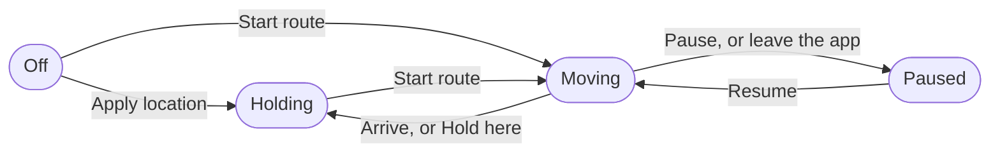

<div align="center">



<br>

<a href="https://github.com/ezzuldinSt/LSpoof/releases/latest"></a>


<a href="https://github.com/ezzuldinSt/LSpoof/releases"></a>

<h3>Choose where a sideloaded iOS app thinks you are.</h3>

Hold one spot, play a route at walking or driving speed, and keep the places you use one swipe away,<br>all from a picker that floats inside the app.

<a href="https://github.com/ezzuldinSt/LSpoof/releases/latest/download/LocationSpoofer.dylib"></a>

[**Get started**](#-get-started) &nbsp;·&nbsp; [**Guides**](#-guides) &nbsp;·&nbsp; [**How it works**](#-how-it-works) &nbsp;·&nbsp; [**FAQ**](#-faq) &nbsp;·&nbsp; [**Build**](#-build-from-source)

</div>

<br>

> [!TIP]
> **New in 1.5:** routes now **resume after a relaunch**, you can **save named routes**, and each leg of a route can **walk or drive at its own speed**. One-shot location requests are answered right away, even indoors, and Google Maps share links work again.

## ✨ What it does

<table>
<tr>
<td width="33%" valign="top">

### 📍 Hold any spot
Search, tap the map, type coordinates or paste a map link. The app sees you there until you turn it off.

</td>
<td width="33%" valign="top">

### 🗺️ Routes with stops
Up to 10 stops. Walk, bike or drive, and give each leg its own path and speed.

</td>
<td width="33%" valign="top">

### 🎢 Motion that looks real
Smooth speed-ups, braking for corners and stops, and waits at each stop.

</td>
</tr>
<tr>
<td valign="top">

### 🔗 Map links, both ways
Paste places and directions from Apple Maps, Google Maps or Waze. Share a route back to any of them.

</td>
<td valign="top">

### 📁 GPX, TCX and FIT
Replay a recorded trip at its own pace, or export a route for Garmin and Strava.

</td>
<td valign="top">

### ⏰ Schedules
Start a spot or a route later, turn it off at a set time, and repeat it every day.

</td>
</tr>
<tr>
<td valign="top">

### ⭐ Saved places and routes
Up to 50 of each, with swipe actions, a map preview and Undo.

</td>
<td valign="top">

### 🔁 Picks up where it stopped
If the app closes mid-route, **Resume route** carries on from the last checkpoint.

</td>
<td valign="top">

### 🌫️ Natural wander
A held spot can drift a little, at a varying pace, like a real GPS fix.

</td>
</tr>
</table>

<br>

## 🚀 Get started

LSpoof is a dylib you add to an app's IPA. It only changes what **that one app** sees, on your own device. It needs an **arm64 iPhone or iPad on iOS 16 or later**.

> [!IMPORTANT]
> The IPA must be **decrypted**. App Store apps are encrypted, and an encrypted IPA installs but crashes or won't open once it's re-signed. Decrypt a copy from your own device with a decryption tool, or use one you already have the rights to.

The steps below use **Google Maps**, which reads your location the way LSpoof covers. It's the app every release is tested in.

| | Step | How |
|:-:|---|---|
| **1** | **Download** | Get [`LocationSpoofer.dylib`](https://github.com/ezzuldinSt/LSpoof/releases/latest/download/LocationSpoofer.dylib) and `SHA256SUMS` from the [latest release](https://github.com/ezzuldinSt/LSpoof/releases/latest). |
| **2** | **Inject** | Add the dylib to your decrypted Google Maps IPA with an injection tool such as **Sideloadly** (its *Inject dylibs/frameworks* option), **Feather** or **Azule**. |
| **3** | **Install** | Sign and install the result with **Sideloadly**, **AltStore** or **SideStore**. With a free Apple ID, refresh the app every 7 days. |
| **4** | **Open** | Open Maps and tap the floating **Location** button. That's the LSpoof picker. |

**To update**, swap the new dylib in for the old copy, re-sign the IPA and reinstall it with the same tool.

<details>
<summary><b>Check the download</b></summary>

<br>

Put `LocationSpoofer.dylib` and `SHA256SUMS` in the same folder, then:

```sh
# macOS
shasum -a 256 -c SHA256SUMS

# Linux
sha256sum -c SHA256SUMS
```

On Windows, run `Get-FileHash LocationSpoofer.dylib` in PowerShell and compare the hash with the one in `SHA256SUMS`.

</details>

> [!NOTE]
> Google sign-in, notifications and other features tied to the app's entitlements can behave differently in a re-signed app. That comes from re-signing, not from LSpoof.

<br>

## 🧭 Guides

**Open the picker** by tapping the floating **Location** button. If you've hidden the button, hold **three fingers** on the screen for a moment instead.

The picker has three tabs: **Location** for one spot, **Route** for a trip, and **Saved** for the places and routes you keep. The header always shows what the app sees right now: **Off**, **Holding location**, **Moving** or **Paused**.

<details>
<summary><b>Everything the floating button can do</b></summary>

<br>

- **It shows the state at a glance:** plain glass when off, and a coloured disc with its own symbol while holding, moving or paused. While a route plays, a ring around it fills up with progress.
- **Move it anywhere.** Drag it, or throw it: it lands on the side you threw it toward and remembers its spot. After a few seconds without use it fades back so it stays out of the way.
- **Tuck it away.** Push or flick it into the left or right edge and it becomes a small tab, which still shows route progress. Tap the tab to bring it back.
- **Touch and hold it** for quick actions without opening the picker:
  - the live status;
  - **Slower · Pause · Faster** while a route plays (the menu stays open, so you can tap several times);
  - **Stop and hold here**;
  - **Resume route** after a route stopped part-way, with where it carries on from and the time left;
  - **Apply last location** when off;
  - **Open LSpoof**, **Tuck into edge**, and **Turn off** when on.
- **VoiceOver** offers the same actions, plus moving the button, as custom actions.
- **The three-finger shortcut** needs at least three fingers held for 0.8 seconds. Lifting below three fingers cancels it, and closing the picker with fingers still down waits for you to let go before it can open again.
- The button only takes touches on itself and never takes over the app's key window. It's tracked per window, and survives the app going to the background and back. You can hide it in Settings.

</details>

### Hold a location

<p align="center"></p>

1. **Find the spot.** Search, tap a category such as **Coffee** or **Hotels**, tap the map to drop a pin, or use **Coordinates**, **Link** or **My location**.
2. **Check it.** The card shows the place name and its coordinates. Drag the pin to fine-tune it.
3. **Tap Apply location.** The header changes to **Holding location** and the app sees you there. Close the picker and carry on.

**Turn off** at the bottom always stops spoofing, and the app gets its real location again.

<details>
<summary><b>All the details</b></summary>

<br>

- **The map fills the picker**, with the header, the place card and the buttons floating over it on glass (Liquid Glass on iOS 26, a blur before that).
- **The header shows what is applied now**, separately from the spot you're looking at. Touch and hold it to copy the coordinates being held.
- **Search suggests places as you type**, with the matching text in bold and the distance and direction from the centre of the map. Before you type, it offers categories: Coffee, Restaurants, Hotels, Parks and more.
  - Pasted coordinates or a map link turn into a **Use …** row.
  - When nothing is found, **Search a wider area** tries again over a bigger region.
- **Pins:** tap the map to drop one (double-tap still zooms), and drag a pin to move it. A dropped pin gets the street name when one is found.
- **Apply location** (or **Replace location** while something is applied) stops any route that is moving or paused and holds the new spot.
- **Remember last selection** in Settings keeps the last spot ready to preview and apply again. Turning that setting off forgets it.
- **Offline**, coordinates and saved places still work. Map errors offer **Retry**, and search errors explain how to try again or enter coordinates instead.
- Search and directions requests are cancelled when you change what you typed, switch tabs, close the picker or leave the app, so an old answer can never replace a newer one.

</details>

### Play a route

<p align="center"></p>

1. **Set From and To.** Search, use coordinates or a saved place, or tap the map. **Map taps set** (From / Stop / To) decides what the next tap fills in. Add up to **10 stops** in between.
2. **Pick the path:** **Walking path** or **Driving path**. Each leg between stops can have its own.
3. **Pick the speed and motion:** Walk (5 km/h), Bike (15 km/h), Drive (50 km/h) or a custom speed, then **Steady speed** or **Smooth**.
4. **Tap Start route** (or **Replace with this route** when something is already applied).

While it plays, the top of the Route tab shows the **time left**, your speed, the arrival time and a progress bar with the stops marked. **Slower** and **Faster** change the speed live.

<details>
<summary><b>Planning a route</b></summary>

<br>

- **Stops:** each stop's menu can change it, move it earlier or later, or remove it. Pins can be dragged, and **Reverse the route** flips From, To and the stops.
- **Paths:** directions are fetched leg by leg through every stop. Changing the path type fetches them again.
- **Speeds:** Walk 5 km/h, Bike 15 km/h, Drive 50 km/h, or a custom value from 1 to 500 km/h. Bike is a speed, not cycling directions. Imported tracks with times also offer **Recorded**, which replays the trip at its own pace.
- **A different way for each leg.** With stops, each leg (From to the first stop, stop to stop, the last stop to To) can go its own way, for example drive to a car park, walk to a stop, then drive on.
  - The row under From and under each stop shows how the next leg goes, with a walking or car marker on the line.
  - Tap that row, or open **Next leg** in the stop's menu, to choose the leg's **Walking path** or **Driving path** and its speed: **Route speed** (the playback speed), Walk, Bike, Drive or a custom value.
  - Choosing a path the route doesn't use also sets the matching speed (Walk 5 km/h, Drive 50 km/h), which you can change.
  - Changing one leg's path looks up only that leg. A speed change needs no lookup and applies right away, even while the route plays.
  - Legs left on the route's path and speed follow the route when those change.
- **Motion:** **Steady speed**, or **Smooth** (Gentle, Normal or Sporty), which speeds up from a stop, slows for corners and brakes before stops and the destination. Where walking and driving legs meet, smooth motion comes to a stop and sets off again at the new leg's pace, and each leg speeds up and brakes like its own mode.
- **Wait at each stop:** pause at every stop for 15 seconds to 5 minutes, or a custom time.
- **Finish in** works out the speed for you:
  - **Match Apple Maps** uses Apple's arrival estimate;
  - **As recorded** keeps a track's own timing;
  - **Finish in…** takes a trip time in minutes, waits included.

  It changes the route speed. Legs with their own speed keep it, so when every leg has its own speed there is nothing for it to change.
- **Starting:** a new route draft leaves whatever is applied running until you start it. **Replace with this route** asks first, then starts at From.
- **Saving:** the bookmark button next to **Share** saves the route under a name (see [Save places and routes](#save-places-and-routes)).

</details>

<details>
<summary><b>While a route plays</b></summary>

<br>

- **The planner folds into one line.** **Edit route** opens it again and **Done** folds it.
- **On the map,** a new route draws itself in, the part already travelled turns grey, and passed stops become checkmarks. The applied position has its own marker.
- **Live changes:** **Slower** and **Faster** change the speed without restarting. On a leg with its own speed they step that leg's speed, and the card says **on this leg**. Changes to motion, waits or speed apply to the route that is playing. Removing a stop can be undone.
- **The numbers agree:** the time left, **Finish in** and exported files all time each leg at its own speed, the same way playback does. The countdown keeps going while the route waits at a stop.
- **Pause / Resume**, **Hold here** and **Turn off** each do something different, and route controls stay available from the Location and Saved tabs through a labelled menu.
- **Arriving** holds the destination and keeps it, even with the picker closed. **Replay route** starts the same path again from From.
- **Paused** locations report a speed of zero.
- **Leaving the app** pauses playback, and it resumes when you come back. A route you paused yourself stays paused.
- **Keep routes moving in the background** (in Settings) keeps playback going for as long as iOS keeps the app running in the background, for example in an app with background location. iOS still suspends most apps, and a suspended route carries on from where it was when the app wakes up.
- How often the app hears about the new position still depends on how the app itself uses Core Location.

</details>

<details>
<summary><b>Resume after a relaunch</b></summary>

<br>

When a route starts, LSpoof writes it to a file in the app's Application Support folder: its places, path, stops and name, in the versioned format described in [`Source/LSRouteArchive.h`](Source/LSRouteArchive.h). Every five seconds, and when you pause, it also saves a checkpoint with the distance covered, the next stop, any wait left at a stop, and the speed, motion and waits.

If the app quits or is closed part-way through a route:

- The next launch holds the last checkpoint, as before.
- It also offers **Resume route**, with where it carries on from and what's left ("From about 3.2 km · 12 min left"). You'll find it on the Route tab (the picker opens on it) and in the floating button's touch-and-hold menu.
- **Resume route** continues from that point with the same speed, motion and waits, each leg's own path and speed, and the rest of any wait at a stop. **Replay route** starts over from From.

**Stop and hold here** leaves the same offer. A route that has arrived offers nothing to resume, and applying another location or **Turn off** clears the saved route. If the saved route can't be read, LSpoof keeps the held location and quietly drops the route.

</details>

### Go to exact coordinates

<p align="center"></p>

1. **Tap Coordinates** on the Location tab, or in any place search.
2. **Paste or type.** One field reads decimal pairs (`48.8584, 2.2945`), degrees, minutes and seconds (`48°51'29.6"N 2°17'40.2"E`) and Apple Maps, Google Maps or Waze links. There are also separate latitude and longitude fields with N/S and E/W switches.
3. **Fine-tune and use it.** Drag the small map to adjust the spot, with **Undo**, then tap **Use this spot**.

<details>
<summary><b>All the details</b></summary>

<br>

- Input accepts negative values, your language's digits, and a decimal point or comma.
- Errors appear beside the field, with a symbol. Typing never rewrites what you're entering.
- With a keyboard, Option-arrow keys nudge the spot.

</details>

<details>
<summary><b>Map links</b></summary>

<br>

**Bring a place or directions in.** Share it from Apple Maps, Google Maps or Waze, then use **Link** on the Location tab or **Import → Paste map link** on the Route tab.

- Short links such as `maps.app.goo.gl` are opened first to see where they point.
- A link to one place becomes a location, or the selected endpoint on the Route tab.
- A directions link fills From, the stops and To, and picks the walking or driving path and speed from the link. Only the first 10 stops are kept.
- A link that starts at "My location" uses the applied location, or your real location, or asks you for From.

**Send a route out.** **Share route** creates an Apple Maps, Google Maps or Waze link.

| App | What the link keeps |
|---|---|
| Apple Maps | Every stop. The device that opens it needs iOS 18.4 or later to show them. |
| Google Maps | From, To and up to 9 stops. |
| Waze | Only the destination, and it always drives. |

A link has one travel mode for the whole trip, so it uses the first leg's. When the legs differ, the share menu says so under the Apple Maps and Google Maps links.

</details>

<details>
<summary><b>GPX, TCX and FIT files</b></summary>

<br>

- **Import → Open GPX, TCX or FIT file…** plays back a recorded trip. LSpoof uses the track points first, then route points, then waypoints. A track with times can play at its recorded pace, sped up or slowed down with **Finish in**.
- **Share route → Export** writes the route as GPX, TCX (for Garmin and Strava) or a FIT activity. It's timed at the speed, motion and waits you chose, with each leg at its own speed. A file names one activity type: with mixed legs, it's the longest leg's.
- The exports were checked with Garmin's FIT SDK and common GPX and TCX readers.

</details>

### Save places and routes

<p align="center"></p>

- **Tap** a saved or recent place to preview it on the Location tab, then **Apply** it.
- **Swipe right** to apply it straight away, **swipe left** to rename or delete it.
- **Touch and hold** (or tap **···**) for a map preview and a menu: Preview, Rename, Copy, Share, Wander radius, Move and Delete.
- **Recently applied** keeps your last five spots, so a place you used is never lost.

<details>
<summary><b>Saved places</b></summary>

<br>

- **Save place** asks for a name. You can keep up to 50 places. At the limit, new saves are refused with a message, and existing places are never pushed out. Older lists with more than 50 entries stay as they are, and new saves wait until you're below the limit.
- Each row shows the distance, when it was saved or used, and its wander radius.
- **Reorder** mode adds drag handles and only moves saved places.
- Deleting a place, removing a recent and **Clear** happen at once and offer **Undo**.
- With six or more saved places, a filter field appears. If nothing matches, you can search for places with the same text.
- **Recently applied** keeps up to five different spots and uses the searched or saved name when there is one.
- **Wander radius** in a place's menu sets how far that place may drift while held: the Settings radius, no drift, 10 to 250 m, or a custom value up to 1,000 m. Applying the place uses its radius.

</details>

<details>
<summary><b>Saved routes</b></summary>

<br>

- **Saving:** once a route is built or imported, the bookmark button next to **Share** on the Route tab asks for a name and saves the whole route:
  - From, the stops and To;
  - the walking or driving path with its streets, so it opens again without new directions, even offline;
  - each leg's own path and speed;
  - a recorded track and its timing;
  - the speed, motion and waits.

  The button fills in once the route is saved. Tapping it again offers to save another copy. You can keep up to 50 routes, and existing routes are never pushed out.
- **On the Saved tab,** saved routes have their own section between saved places and recents, newest first. Each row shows the distance, the number of stops, the path type, when it was saved, and From → To.
- **Tap a route** to open it in the Route planner as a draft. It doesn't start until you tap **Start route**. Opening it also sets the planner's speed, motion and waits to the saved ones.
- **Swipe right** to **Start** it (it asks first if it would replace what's applied). **Swipe left** to rename or delete it.
- **Touch and hold** for a map preview of the whole route and a menu: Start route, Open in Route planner (Preview), Rename, Share and Delete. Deleting offers **Undo**.
- **Share** sends a planned route as an Apple Maps link through its places, and a recorded track as a GPX file.
- **The filter field** matches route names and the names of the places they pass through. It appears once saved places and routes add up to six.
- Saved routes are kept in a JSON file in the app's Application Support folder rather than in its preferences, because a recorded track can be large.

</details>

### Schedule it

<p align="center"></p>

1. **Tap the clock** next to **Apply location** or **Start route**.
2. **Pick when it starts:** a date and time, or a quick choice such as **In 15 min** or **In 1 hour**.
3. **Optionally** turn it off at a set time, or repeat it every day, then tap **Schedule**.

The summary at the top says when it starts and ends. While something is scheduled, the clock shows a dot: tap it to see the summary, **Change** the schedule, or **Cancel schedule** (with **Undo**, unless a scheduled route has already started).

> [!NOTE]
> iOS only lets LSpoof act on time while the app is open or running in the background. If the app is closed at the start time, a scheduled location is applied the next time you open it, and a scheduled route is skipped if it's more than 15 minutes late. The picker tells you when a start was late or missed.

### Make it yours

<p align="center"></p>

Tap the **gear** in the picker's header. Changes stay local until you tap **Save** (it's only enabled when something changed). **Cancel**, or swiping down with unsaved edits, asks whether to save or discard them.

| Setting | What it does |
|---|---|
| **Altitude** | The altitude sent with held spots and routes. |
| **Course** | The direction a held spot faces. A route always faces the way it travels. |
| **Wander while holding** | A held spot drifts slowly toward new points inside a radius you choose, at a varying pace, with a little small-scale movement on top. A small street map shows the circle to scale: drag it to resize, or use the slider or an exact value. |
| **Real location on map** | Shows your real position as a separate gray dot on the picker map. The app itself still sees the spoofed spot. |
| **Floating button** | Shows or hides the button. Without it, hold three fingers on the screen to open the picker. |
| **Keep routes moving in the background** | Keeps a route playing after you leave the app, for as long as iOS keeps the app running. |
| **Remember last selection** | Keeps your last spot ready to apply again. |

<details>
<summary><b>Backup and restore</b></summary>

<br>

- **Export backup file** or **Copy backup** saves your saved places, saved routes, recent locations and settings as JSON. **Restore from file** and **Restore from clipboard** bring them back.
- Before restoring, LSpoof shows what the backup contains and asks whether to **merge** it with what you have or **replace** it.
- Saved routes are an extra `routes` list in the same version 1 backup format. Older LSpoof versions ignore them and still restore everything else, and a backup made before saved routes leaves your saved routes alone, even with Replace.
- Routes with recorded tracks make backups larger, up to about 1.6 MB for a 50,000-point track. Files up to 128 MB are accepted, which covers 50 of the largest.

</details>

<details>
<summary><b>Your real location</b></summary>

<br>

- The gray dot uses the permission the app already has. LSpoof never asks for location permission itself.
- It has its own button to centre the map on it, and a message when it isn't available.
- Updates stop when the picker closes, the app goes to the background, or the Saved tab is showing.

</details>

<details>
<summary><b>Accessibility</b></summary>

<br>

- **Text:** Dynamic Type (layouts restack at accessibility sizes), wrapping labels and Bold Text. Button and navigation text scales within limits so actions stay reachable on small screens.
- **Colour:** semantic light and dark colours with Increase Contrast variants. State is never shown by colour alone, and Differentiate Without Color adds symbols and outlines.
- **Motion and transparency:** Reduce Motion swaps springs and moving effects for fades, and Reduce Transparency makes glass surfaces solid.
- **VoiceOver and Voice Control:** names, values and custom actions throughout, with at least 44-point touch targets.
- **Keyboard:** keyboard-aware scrolling, Escape and back to dismiss, **⌘1/⌘2/⌘3** for the tabs, **⌘F** to search, and **⌘S** to save settings or a schedule.
- **No gestures required:** coordinate entry and row menus offer alternatives to map gestures and drag-to-reorder.

</details>

<br>

## 🔧 How it works

<p align="center"></p>

LSpoof loads into the app when it starts (it's added as an `LC_LOAD_DYLIB` load command). From inside the app, it answers the app's location requests with the spot or route you chose. Nothing outside that app changes: it isn't a device-wide GPS override.

LSpoof is always in one of four states:



**Turn off** goes back to Off from any of them. One session controller owns the state for as long as the app runs, and every location the app receives comes from a consistent snapshot of it. Opening or closing the picker never interrupts it.

<details>
<summary><b>What LSpoof hooks</b></summary>

<br>

| Hook | What happens while LSpoof is on |
|---|---|
| `CLLocationManager.setDelegate:` | Delegates from the app (not from system frameworks) that implement `locationManager:didUpdateLocations:` or the legacy `locationManager:didUpdateToLocation:fromLocation:` receive simulated locations. Both legacy arguments use simulated history. |
| `locationManager:didFailWithError:` | On the same delegates, only `kCLErrorLocationUnknown` (no real fix yet, for example indoors) is held back. A simulated location is delivered instead if none arrived in the last 10 seconds or since the last `requestLocation`. `kCLErrorDenied` and every other error always reach the app. |
| `startUpdatingLocation` / `stopUpdatingLocation`<br>`startMonitoringSignificantLocationChanges` / `stopMonitoringSignificantLocationChanges` | Register the managers the app is running, so they get simulated locations even while the phone lies still: every second while moving, and whenever a new spot is applied. Standard updates honour the app's `distanceFilter`, and significant-change monitoring delivers only after about 500 m, as iOS does. Only managers created on the main thread are covered. In the background, only standard updates the app allowed there, and significant changes with Always access. |
| `CLLocationManager.requestLocation` | A one-shot request on a main-thread manager gets one simulated location right away instead of waiting for a real fix, and no real fix or failure follows it. Requests from other threads go to iOS, and their result is replaced as above. `stopUpdatingLocation` cancels a pending answer. |
| `CLLocationManager.location` | The synchronous getter returns the simulated location. |
| `MKUserLocation.location` | MapKit's user location returns the simulated location. |

- **Speed and course:** simulated locations carry valid speed and course accuracies. While moving, they report the route's speed and direction of travel. While holding, the speed is 0 and the course is the one set in Settings. While paused, the speed is 0 and the course is marked invalid, as on a phone standing still.
- **When LSpoof is off,** every hook passes the original values and calls straight through.
- **Permissions stay real.** Authorization status and Location Services availability always come from iOS: an app without location access gets iOS's own answer to every request.
- **Touches:** the floating button works by wrapping `UIApplication.sendEvent:`, keeping the original implementation. It handles custom `UIApplication` subclasses, and the picker opens in the window you were using.

</details>

<details>
<summary><b>What LSpoof doesn't cover</b></summary>

<br>

- Swift's `CLLocationUpdate.liveUpdates()` and `CLBackgroundActivitySession`
- Heading (compass) callbacks
- Visits and geofences
- Delegates that belong to system frameworks
- Location from the cell network, Wi-Fi or IP address, and server-side IP checks

Whether a particular app works depends on how it reads your location, so test with the app you use.

</details>

<br>

## ❓ FAQ

<details>
<summary><b>The app installs but crashes or won't open.</b></summary>

<br>

The IPA is almost certainly still encrypted. Decrypt it first (see [Get started](#-get-started)), then inject and sign it again.

</details>

<details>
<summary><b>Does it change my location in other apps?</b></summary>

<br>

No. LSpoof only lives inside the app you injected it into. Every other app, and the system, still sees your real location.

</details>

<details>
<summary><b>The app still knows roughly where I really am.</b></summary>

<br>

Some apps also estimate your location on their servers from your IP address or network. That happens outside the app's location requests, so LSpoof can't change it.

</details>

<details>
<summary><b>My route stops when I leave the app.</b></summary>

<br>

That's the default: leaving the app pauses the route, and it resumes when you come back. Turn on **Keep routes moving in the background** in Settings to keep it going. iOS still suspends most apps after a while, and the route carries on from where it was when the app wakes up.

</details>

<details>
<summary><b>The app was closed in the middle of a route.</b></summary>

<br>

Open it again and tap **Resume route** on the Route tab, or in the floating button's touch-and-hold menu. It carries on from the last checkpoint with the same speed and settings.

</details>

<details>
<summary><b>A scheduled route didn't start.</b></summary>

<br>

iOS only lets LSpoof act while the app is open or running in the background. A scheduled route that would start more than 15 minutes late is skipped, and the picker tells you. A scheduled location is applied the next time you open the app.

</details>

<details>
<summary><b>Sign-in or notifications don't work.</b></summary>

<br>

Those features depend on the app's original entitlements, which re-signing can change. It happens with or without LSpoof.

</details>

<br>

## 🧰 Build from source

Install [Theos](https://theos.dev/docs/Installation-Linux.html) and set `THEOS` to its folder, then run:

```sh
make clean
make FINALPACKAGE=1 DEBUG=0
```

The release build is `.theos/obj/LocationSpoofer.dylib` (optimized, stripped and ad hoc signed). For a debug build, run `make DEBUG=1`. It goes to `.theos/obj/debug/LocationSpoofer.dylib`.

<details>
<summary><b>Tests, CI and toolchain</b></summary>

<br>

- **Tests:** `Tests/run.sh` runs the host tests for the motion model, the track codecs, GPX/TCX/FIT reading and writing, map links, and the saved route format and store. The C tests need only a C compiler (`Tests/run.sh c`). The Objective-C tests use Foundation on macOS, or GNUstep on Linux:

  ```sh
  apt install clang gnustep-make libgnustep-base-dev libblocksruntime-dev
  ```
- **CI:** the GitHub Actions workflow in [`.github/workflows/build.yml`](.github/workflows/build.yml) is set up to run the tests and the same release build on pushes to `main`, pull requests and `v*` tags, and to attach **LocationSpoofer.dylib** and **SHA256SUMS** to each run.
- **Toolchain:** the SDK is pinned to iPhoneOS **16.5**, with an iOS **16.0** deployment target, `arm64` and ARC. The Linux build is verified with Theos revision `dd5c14bb9d91311e221d51b5bfb8c9e5948156db` and the official Linux Clang 11.1.0 toolchain.
- **README art:** the banner, diagram and guides in [`assets/readme`](assets/readme) are generated from the screenshots in `assets/readme/screens`. After changing either, run `python assets/readme/build.py`.

</details>

<br>

<div align="center">

<sub>LSpoof only changes what one app on your own device sees. Use it with apps you have the right to modify, and respect their terms.</sub>

<br><br>

<a href="#top"></a>

</div>
